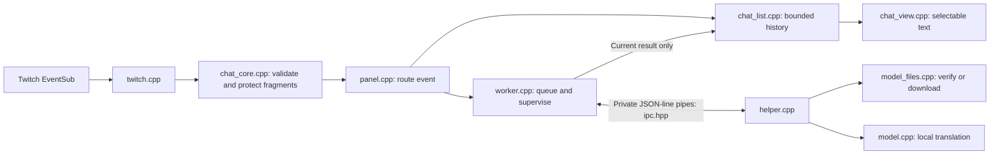

# Reviewing Awl Interpretwitch

This guide describes the 0.4.0 source layout. Start here to trace what executes,
what it can access and where to check the implementation. User instructions are
in [README.md](README.md); failure handling and its limits are in
[ISOLATION.md](ISOLATION.md). Build prerequisites and checks are in
[BUILD.md](../BUILD.md). Documentation is a map, not an audit
certificate or a guarantee that native code cannot fail.

## Follow one message

The client, parser, panel, history/view and supervisor run inside OBS. The helper,
model file access and inference run in a separate process. A pending translation slot and optional original appear
immediately; a result fills the slot only if it belongs to the current work generation
and its row still exists. Selection can defer display replacement. The helper
receives message text and protected fragments, not account tokens or separate
channel/user metadata. Text itself can contain names, links and other private data.

## Source responsibilities

| File | Responsibility |
| --- | --- |
| `src/plugin.cpp` | OBS load/unload, module paths, TLS setup and dock registration. |
| `src/panel.cpp` | Builds controls, binds worker/Twitch callbacks, routes events and saves preferences. Construction, bindings and restored startup are separate methods. |
| `src/twitch_setup.*` | One scrollable registration guide with all four steps, Field: Value entries and explicit browser/copy buttons. It holds a draft ID and emits save/cancel callbacks; it does not persist settings, sign in or download models. The panel persists only an explicitly saved, format-validated ID. |
| `src/ui_text.*`, `data/locale/ru-RU.json` | English source strings and embedded Russian translations. OBS chooses the locale at startup. No global Qt translator, OS-locale override or translation-service request. The helper receives the same canonical language in its prepare command. |
| `src/text_menu.*` | Native editing actions with localised labels, attached only to this plugin's text fields/view. Existing text selection and keyboard editing remain native Qt. |
| `src/chat_list.*` | Memory-only message history, updates, moderation removals and retention. No network, credentials or process access. |
| `src/chat_view.*`, `src/chat_style.hpp` | Literal text display, native selection, scrolling, translated-message borders and static dock styling. |
| `src/twitch.*` | Device sign-in, token validation/refresh, EventSub connection and reconnect. |
| `src/credentials.*` | OS credential-store operations. This is the only account-token persistence implementation. |
| `src/chat_core.*` | Shared value types, incoming-event validation, protected text and bounded translation queue. |
| `src/worker.*` | Parent process supervisor: launch, deadlines, cancellation, stale-result rejection and limited recovery. It cannot instantiate the translation engine. |
| `src/ipc.hpp` | Versioned JSON framing and the text-only translation payload. |
| `src/helper.cpp` | Child entry point, pipe reader, command dispatch and process restrictions. |
| `src/model_files.*` | Validate the complete catalogue, verify cached files, stream explicit downloads and promote verified files atomically. No inference dependency. |
| `src/model_profile.*` | Stable Light/Heavy identities, explanations, isolated cache paths and language routing. No process or download side effects. |
| `src/model.*` | Language detection, tokenization, inference and bounded translation cache. No download, credential or UI code. |
| `src/limits.hpp` | Shared retention, message, queue and decoding bounds. Local transport details and supervisor timing overrides stay with their owners. |
| `src/model_download.*` | HTTPS transport. Callers own catalogue validation, file writes and hash verification. |

## Network, files and execution

| Boundary | Current behaviour and review location |
| --- | --- |
| Twitch network | `twitch.cpp` calls `id.twitch.tv` for OAuth, `api.twitch.tv` for channel lookup/subscriptions, and `eventsub.wss.twitch.tv` for incoming events. It requests `user:read:chat`; there is no send-chat operation. |
| Model network | `model_files.cpp` accepts initial HTTPS catalogue URLs at `huggingface.co` and `dl.fbaipublicfiles.com`. Shared transport permits HTTPS redirects, including CDN hosts. The final bytes must match the pinned size and SHA-256 before promotion. Downloads require the explicit model action; normal message translation does not send text to a remote translator. |
| External browser | `twitch_setup.cpp` opens the fixed Twitch registration link only when clicked. `panel.cpp` opens the validated activation URL during sign-in. Chat text is inserted literally and does not trigger browser or shell execution. |
| Clipboard | `twitch_setup.cpp` copies the fixed redirect URL only on its copy action. Native text menus and standard keyboard actions copy/paste only when requested. No background clipboard access. |
| Settings | `settings.ini` under the OBS module configuration directory contains channel, public Client ID, remember-sign-in, display, device, model identity and connection preferences. It contains no account token or transcript. See `plugin.cpp` and `Panel::save_settings`. |
| Account tokens | Keychain service `org.awl.chat.twitch` / account `read-only-chat` on Mac; Credential Manager target `AWL/Chat/Twitch` on Windows. Disconnect requests deletion; failure is reported. Unsupported platforms use session-only credentials. |
| Models | Light retains the module's `models` directory; Heavy uses its `m2m100-418m-int8` subdirectory. Only one model is resident. A force-stopped download can leave an uncommitted temporary file. The engine does not load it. |
| History and diagnostics | Chat history and translation cache live in memory. First-party code writes no transcript or telemetry. `plugin.cpp` emits fixed lifecycle/TLS messages to the OBS log; helper stderr is discarded. This is not a guarantee about OS crash reports or third-party library diagnostics. |
| Process launch | `worker.cpp` launches the installed helper directly with the fixed `--stdio` argument. Chat is sent through bounded pipes, never a shell command. The helper runs as the same OS user: process separation is not a filesystem/network security sandbox. |
| Installation | `scripts/install-mac.sh` stages the bundle, verifies it and backs up an existing AWL Chat bundle before replacement. Runtime code does not install or update itself. Build/packaging scripts are developer tools, not a background service. |

## Build boundaries and dependencies

`CMakeLists.txt` is the authoritative production target map:

- `awl-chat` → UI, history/view, Twitch/credentials, shared protocol and supervisor.
- `awl-chat-worker` → shared protocol, model files and inference.
- `awl-chat-model-files` → QtCore and the shared HTTPS transport (system libcurl
  on Mac, WinHTTP on Windows).
- `awl-chat-model` → CTranslate2, SentencePiece and fastText. Their headers are
  private to this target; none is linked into the OBS module.
- `awl-chat-text` → QtCore and the embedded Russian catalogue. Both processes use
  this small library. `ui_error` shows known messages in the chosen language and
  substitutes a localised fallback for unknown library diagnostics.

The dock uses OBS's matching Qt libraries, with the additional WebSockets and TLS
components staged by `scripts/package.py`. Dependency versions, download sizes and
hashes are in `dependencies.lock.json`; model sources and hashes are separately
listed in `data/models.lock.json` and `data/models-heavy.lock.json`. Licences and model-conversion provenance are in
[THIRD_PARTY_NOTICES.md](THIRD_PARTY_NOTICES.md). Dependencies are not hidden by the
small size of our own source: their native implementations also need review.

The Mac build currently extracts the CTranslate2 dylib from a pinned upstream
wheel; it does not build that library from our bundled source archive. A matching
source archive and checksums improve inspectability, but do not establish a
reproducible build or independently prove source-to-binary equivalence.

`tests/CMakeLists.txt` owns all tests, fault fixtures and diagnostic tools.
`BUILD_TESTING=OFF` excludes them from a production-only build; release validation
must still use a build with tests enabled. Test executables are never installed.
The CMake project version supplies the module log, bundle metadata and package
receipt. There is no separately maintained version string in executable code.

## Review and validation workflow

1. Read the entry point and CMake links, then follow the message path above.
2. Review side effects in Twitch, credentials, model files, shared transport and
   process launch. Check pinned dependencies and their licences separately.
3. Build and run the existing checks using `scripts/build-mac.sh` with the prepared
   matching toolchain. It stages a development package but does not install it.
4. Review `package.json` beside the staged bundle, its signatures and bundled
   `Contents/Resources/source.zip`. Source availability is distinct from a review
   of the compiled third-party components or a trusted publisher signature.

The six CTest suites cover protocol/authentication, native selection/history,
model verification, subprocess failures, locale coverage and setup/localised UI.
The real-model device check separately
exercises CPU inference, device switching and fallback through the helper.
Production and test C++ use `.clang-format`; prefer ordinary statements and
explicit ownership over compressed lines or new general-purpose frameworks.

Windows/NVIDIA execution and live OBS/gameplay acceptance remain unvalidated.

## Resource choice and pending messages

The selected allowlisted model identity travels in `prepare` and must match the
helper's `ready` reply. Light is OPUS-MT; Heavy is M2M100 with source language tokens
and a Russian target prefix. Both use the same inference runtime, language detector
and download verifier, with separate file sets and size ceilings (256/512 MiB).
No model files are bundled. The original Light catalogue/pins remain unchanged.

`ChatList::Row::pending` controls a fixed text placeholder. `ChatView` paints an
arc into its reserved space; one 250 ms timer repaints only visible arc regions.
The timer stops with no visible pending messages, on hide, or after completion.
It never modifies document text/layout. Selection continues to defer replacement
until released; the spinner itself stops immediately even on a selected message.

`Worker::discarded` resolves pending rows when a queue entry overflows/expires,
a generation is cancelled, preparation fails or the helper fails. Completed,
unsupported and uncertain results also clear pending state. Removed history never
reappears from a late reply. Chat text remains literal and selectable.

Heavy uses one CPU inference thread because sparse incoming chat can wait; Light
retains two. The helper cache is per model instance and disappears on a switch.
The helper is private to this plugin. The text-only IPC boundary keeps inference
separate from Twitch and the dock, allowing future reuse without coupling the
current plugin to an audio project or background service.
