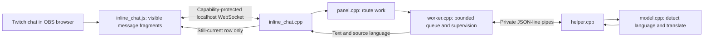

# Reviewing Interpretwitch

Version 0.8.1, by Salvador Stream Labs. This source map describes executable
behaviour; it is not an audit certificate or a guarantee against native failures.

## Follow one message

OBS/Twitch owns authentication, chat history, original DOM, settings and moderation.
There is no Interpretwitch OAuth, EventSub connection or duplicate chat renderer.

| Source | Responsibility |
| --- | --- |
| `src/plugin.cpp` | OBS lifecycle, Tools menu action and modeless settings window. Starts after OBS finishes loading. |
| `src/panel.*` | Model/device/appearance preferences and bridge/worker callbacks. Loads the cached model after a chat page connects; explicit button permits downloads. |
| `src/twitch_dock.*` | Finds only OBS’s `twitchChat` dock, verifies browser-panel ABI 3 and widget type, executes the bundled script. |
| `src/inline_chat.*` | Temporary local listener, origin/capability checks, bounded requests, page/job IDs and connection cleanup. |
| `data/inline_chat.js` | Bounded DOM observation, visible fragment extraction, presentation, scroll preservation and stale/deleted result rejection. Never reparents original Twitch elements. |
| `src/chat_core.*`, `src/limits.hpp` | Protected text fragments, repetition guard, bounded jobs and expiry. |
| `src/worker.*`, `src/ipc.hpp` | Separate-process supervisor, bounded pipes, generation checks, timeouts and restart policy. |
| `src/helper.cpp`, `src/model.*` | Local fastText detection and CTranslate2 translation. Source-language metadata travels with each result and cached result. |
| `src/model_profile.*` | Light/Heavy and target identity, language eligibility and stable cache paths. |
| `data/languages.json` | Reviewed target allowlist, English/Russian names, compact Russian pill labels and available Light pack sizes. Model codes match the pinned Heavy vocabulary. |
| `src/model_files.*`, `src/model_download.*` | Pinned file verification, explicit HTTPS downloads and atomic cache promotion; helper-only. |
| `src/ui_text.*`, `data/locale/ru-RU.json` | OBS-selected English/Russian strings, also passed to the helper and browser adapter. |
| `third_party/obs-browser/` | Unmodified, pinned upstream interface header and provenance. No second browser runtime. |

The plugin uses Qt Core/Widgets/Network/WebSockets. Translation libraries and HTTPS
download implementation are linked only into the helper. No credential-store or
Twitch API client code remains. Qt TLS plugins are no longer bundled: the bridge
uses loopback, OBS manages Twitch TLS, and the helper uses system HTTPS libraries.

## Review checks

Seven CTest suites cover text/language routing, UI preferences, localisation,
file verification, helper failures and the bridge. The separate offline Chromium
fixture checks presentation, live-chat scrolling, reading history, input focus,
selection, deletions, hidden/recycled rows, five-message history catch-up,
a 200-message live burst and cleanup. Real-model checks exercise the same helper/bridge
path and source-language metadata. See [BUILD.md](../BUILD.md).

A future shared helper can reuse the model/IPC boundaries, but is not implemented.
The chat helper receives text parts, never audio or browser/account credentials.
Stable model IDs and cache roots remain independent of presentation and branding.

## 0.8.0 review

The review covered the first-party runtime, browser adapter, tests, build/package
and installation scripts, and the pinned dependency boundaries. Third-party
library implementations were not independently audited line by line. The old
standalone chat renderer/authentication code is absent from the source/target graph.
An unused result flag and unused Qt automatic meta-object generation were removed;
the remaining code uses small concrete components, not a generic plugin framework.

The supervisor publishes explicit Stopped/Preparing/Ready/Recovering/Failed events.
The settings window keeps that state instead of independent loading/ready booleans.
The browser bridge does not know about the worker's implementation: it receives
readiness plus localized status/detail text. The browser derives working/last-reply
display from its existing pending/result flow. No independent health service is added.

Failure checks cover immediate revocation of readiness, no replay on recovery,
bounded reconnects, helper output floods, guarded browser-interface exceptions,
page-script cleanup, and the Windows installer rollback precondition. Details and
remaining native/platform limits are in [ISOLATION.md](ISOLATION.md).

Target selection travels in the helper prepare request and is echoed/validated in
its ready reply. A fresh helper/model instance scopes cached translations to that
target. Heavy targets share one model ID/directory and use the selected decoder
prefix; Light IDs/directories identify the English-to-target pair. Catalogue
identity and target are validated before filesystem access. New Light packs are
fixed manifests, not arbitrary model URLs or executable code from a model hub.
Language names were generated from JavaScript Intl/CLDR; compact Russian labels
are project UI abbreviations, not a separate Russian ISO standard.

The detector admits a top score of at least .60, a score of at least .50 with a
3× lead over the runner-up, or a score of at least .40 with a 10× lead. These are
routing thresholds, not calibrated probabilities. This keeps short phrases such
as “On the left side of the road” from being silently skipped just below .60.
Single-word Latin strings (except supported greetings), unsupported sources,
already-target-language messages and ambiguous results still remain unchanged.
