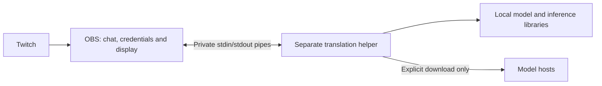

# Translation process isolation

Current implementation: 0.4.0

The native OBS dock now supervises a separate `awl-chat-worker` executable. Model
verification/downloads, SentencePiece, fastText and CTranslate2 (including CUDA)
run in that process. The OBS module links only its UI, Twitch client, protocol and
supervisor code, plus OBS/Qt/system libraries. No inference thread is joined inside
OBS. There is one helper and one resident model, reused across messages.

## Behaviour when something fails

- Missing helper: translation stays unavailable with a reinstall message.
- Helper crash, malformed output or missed deadline: stop that helper and attempt
  one restart. The triggering message remains in its original form and is not
  automatically replayed. Old waiting work is discarded.
- If GPU was selected, recovery after a process failure starts on CPU and reports
  the fallback. Normal GPU initialization exceptions also retain the existing CPU
  fallback behaviour inside the helper.
- A second failure pauses translation and exposes the Download model button to
  retry. Verified cached models are reused. There is no indefinite restart loop;
  an explicit model/device retry resets the allowance.
- Existing Twitch connections and displayed history survive worker recovery.
  Original messages continue to arrive even when translation has stopped.
- Clear/pause invalidates pending results and sends cooperative cancellation to
  the helper. Device/model changes replace the helper after the old process exits.
- Download cancellation and plugin shutdown terminate the helper. Its independent
  stdin reader exits the process when the parent pipe closes, including while the
  inference thread is occupied. There is no detached service or listening port.

The parent event loop supervises startup/model loading (30 seconds), translation
(at most 15 seconds, including the job's remaining queue-age allowance), and each
download attempt (10 minutes). Progress does not extend the total deadline. One
automatic recovery is permitted, so a failed operation can involve two attempts.
These timers depend on OBS's Qt event loop being scheduled. OS process termination
is also subject to the OS; this is not a real-time guarantee against kernel/driver
stalls. Shutdown requests a kill and waits briefly for it to finish.

## Communication and resource boundaries

`worker.cpp` is the parent supervisor; `helper.cpp` is the executable; `ipc.hpp`
defines the small versioned JSON-lines protocol. Messages are limited to 64 KiB,
with strict request IDs, expected reply types and bounded strings. The parent
also passes an allowlisted `en-US` or `ru-RU` locale during preparation so helper
progress and errors match OBS's interface. This changes no translation model or
chat translation direction. The selected allowlisted model identity is also sent
and checked against the ready reply. The parent
holds at most 24 waiting translations and sends one active operation at a time,
plus an optional cancellation control. The child has a bounded two-command input
queue. Oversized or invalid output stops the child. Native stderr is discarded
rather than accumulated in OBS or written as a transcript.

The executable path comes from the installed plugin directory, never chat input.
It is launched directly without a shell. Chat goes through pipes, not command-line
arguments. OAuth credentials and separate Twitch user/channel metadata stay in
the dock; message text can naturally contain names, mentions and links. The helper
inherits a small list of OS/runtime environment variables, not the entire OBS
environment. Unix launches close unrelated file descriptors and disable core dumps.

The Windows implementation uses a private job object limited to one process and
2 GiB of committed host memory. It does not put OBS in that job or limit OBS's
resources. This is a defensive ceiling, not expected memory use, and does not cap
GPU VRAM. Failure to establish the job stops helper startup. This path has not yet
been compiled/tested on Windows. Mac does not currently impose a comparable hard
memory ceiling; the model, queue and message bounds remain in place.

This is **fault isolation, not a full security sandbox**. The helper runs as the
same OS user, can access that user's files and can use the network for downloads.
It is not an AppContainer/restricted-token implementation. Native bugs in the dock
or Qt still run inside OBS, and GPU/OS failures can affect multiple processes.
No 100% guarantee is made. Do not run OBS with elevated privileges for this feature.

Verified model files and atomic download promotion are retained. Force termination
during a write can leave an uncommitted temporary file in the model cache; it is
never used as a completed model. Models are still downloaded only after an explicit
request, and normal translation works offline after Twitch has delivered the text.

## Packaging and validation

The Mac bundle contains the dock and helper in `Contents/MacOS`, with inference
libraries in `Contents/Frameworks`. Both are signed as part of the development
package. The helper uses the matching installed OBS QtCore; there is no duplicated
Qt GUI stack or Python runtime. The packager rejects a dock linked to CTranslate2
or the downloader and rejects developer runtime paths in the installed helper.

Windows install rules include `awl-chat.dll` and `awl-chat-worker.exe` in
`awl-chat/bin/64bit`. A complete, tested Windows dependency package is still
outstanding. The helper executable is a runtime component, not an installer:
ZIP/manual installation remains possible. Sign both components for public release.

`chat-process-isolation` uses a separate **test-only** helper to deliberately crash,
hang, flood stderr and send malformed/oversized/wrong-ID replies. It checks the
parent event loop, recovery limit, CPU fallback, stale results, cancellation,
startup timeout, shutdown, missing helper and production-helper EOF handling.
The fault-injection executable is not installed and production has no crash switch.

`awl-chat-device-check` performs real CPU translation through the production helper,
checks that its PID differs from the parent, tests device changes and stale-result
cancellation, and checks missing models. `--require-gpu` still requires real NVIDIA
execution. `--helper /absolute/path/to/awl-chat-worker` checks a packaged helper.

Development validation includes release/sanitizer tests, real model checks,
package/module/installer checks and dependency inspection.
Sanitizers are configured to fail on detected errors; prebuilt libraries are not
fully instrumented. These are macOS tests, not live OBS/gameplay or Windows/NVIDIA
acceptance. A live OBS session should still be checked after installation.

Version 0.4.0 adds Light/Heavy model identities without changing this process
boundary. Profile switches stop the old helper before starting the next; Heavy
uses one CPU inference thread and has a 512 MiB catalogue cap. Windows' existing
2 GiB helper commit ceiling is unchanged and still untested with Heavy on Windows.
All discarded/failed waiting jobs now notify the history so pending indicators
stop and originals remain readable. `--profiles` extends the real-model check to
Light → Heavy → Light and Heavy startup GPU fallback.
