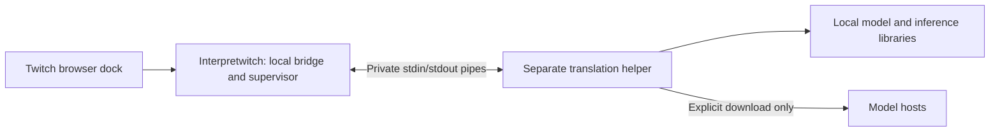

# Translation process isolation

Current implementation: 0.8.3

The OBS plugin supervises a separate `awl-chat-worker` executable. Model
verification/downloads, SentencePiece, fastText and CTranslate2 (including CUDA)
run in that process. The OBS module links only its settings UI, local browser bridge and
supervisor code, plus OBS/Qt/system libraries. No inference thread is joined inside
OBS. There is one helper and one resident model, reused across messages.

## Behaviour when something fails

- Missing helper: translation stays unavailable with a reinstall message.
- Helper crash, malformed output or missed deadline: stop that helper and attempt
  one restart. The triggering message remains in its original form and is not
  automatically replayed. Old waiting work is discarded. Readiness is revoked
  immediately during recovery, including in the page's passive status display.
- If GPU was selected, recovery after a process failure starts on CPU and reports
  the fallback. Normal GPU initialization exceptions also retain the existing CPU
  fallback behaviour inside the helper.
- A second failure pauses translation and exposes the Download model button to
  retry. Verified cached models are reused. There is no indefinite restart loop;
  an explicit model/device retry resets the allowance.
- Browser reconnection does not reset a failed worker's allowance. Explicit
  **Reconnect to chat** can retry cached models. Unexpected inference exceptions
  use the same recovery path as crashes instead of being silently swallowed.
- Existing Twitch connections and displayed history survive worker recovery.
  Original messages continue to arrive even when translation has stopped.
- Page disconnect invalidates pending results and sends cooperative cancellation.
  Disabling translation unloads the helper/model. Device/model changes replace the
  helper after the old process exits.
- Download cancellation and plugin shutdown terminate the helper. Its independent
  stdin reader exits the process when the parent pipe closes, including while the
  inference thread is occupied. The helper has no detached service or listening
  port. The [Twitch-dock adapter](INLINE_CHAT.md) adds a bounded,
  capability-protected loopback listener in the OBS module while enabled.

The parent event loop supervises startup/model loading (30 seconds), translation
(at most 15 seconds, including the job's remaining queue-age allowance), and each
download attempt (10 minutes). Progress does not extend the total deadline. One
automatic recovery is permitted, so a failed operation can involve two attempts.
These timers depend on OBS's Qt event loop being scheduled. OS process termination
is also subject to the OS; this is not a real-time guarantee against kernel/driver
stalls. Shutdown requests a kill and waits briefly for it to finish.

## Communication and resource boundaries

`worker.cpp` is the parent supervisor; `helper.cpp` is the executable; `ipc.hpp`
defines the small versioned JSON-lines protocol (v2 in 0.8.0). Messages are limited to 64 KiB,
with strict request IDs, expected reply types and bounded strings. The parent
also passes an allowlisted `en-US` or `ru-RU` locale during preparation so helper
progress and errors match OBS's interface. This changes no translation model or
chat translation direction. The selected allowlisted model identity is also sent
and checked against the ready reply. The parent
holds at most 24 waiting translations and sends one active operation at a time,
plus an optional cancellation control. The child has a bounded two-command input
queue. Oversized or invalid output stops the child. Native stderr is discarded
rather than accumulated in OBS or written as a transcript.
Pending stdout above two protocol frames is rejected, and each preparation is
limited to 640 status updates (above the complete catalogue's expected maximum).
This bounds valid-looking status floods as well as malformed output.

The executable path comes from the installed plugin directory, never chat input.
It is launched directly without a shell. Chat goes through pipes, not command-line
arguments. Interpretwitch has no OAuth client and reads no account credentials.
Message text can naturally contain names, mentions and links. The helper
inherits a small list of OS/runtime environment variables, not the entire OBS
environment. Unix launches close unrelated file descriptors and disable core dumps.

The Windows implementation uses a private job object limited to one process and
4 GiB of committed host memory. It does not put OBS in that job or limit OBS's
resources. This is a defensive ceiling, not expected memory use, and does not cap
GPU VRAM. Loading Heavy on CPU peaks near 2 GiB, which a 2 GiB ceiling rejected.
CUDA is only initialised in the helper. Before CTranslate2 creates a CUDA context,
the helper checks the NVIDIA driver (`nvcuda.dll` from System32 only), its CUDA
version, the device count and that cuBLAS 12 loads. The optional cuBLAS pack is
downloaded, verified and extracted by the helper, and its folder is added to the
helper's own `PATH` only; OBS's process and the system environment are unchanged.
Failure to establish the job stops helper startup. See
[Windows release preparation](RELEASE_WINDOWS.md) for Windows validation status.
Mac does not currently impose a comparable hard memory ceiling; the model, queue
and message bounds remain in place.

This is **fault isolation, not a full security sandbox**. The helper runs as the
same OS user, can access that user's files and can use the network for downloads.
It is not an AppContainer/restricted-token implementation. Native bugs in the plugin
or Qt still run inside OBS, and GPU/OS failures can affect multiple processes.
No 100% guarantee is made. Do not run OBS with elevated privileges for this feature.

Verified model files and atomic download promotion are retained. Force termination
during a write can leave an uncommitted temporary file in the model cache; it is
never used as a completed model. Models are still downloaded only after an explicit
request, and normal translation works offline after Twitch has delivered the text.

## Packaging and validation

The Mac bundle contains the plugin and helper in `Contents/MacOS`, with inference
libraries in `Contents/Frameworks`. Both are signed as part of the development
package. The helper uses the matching installed OBS QtCore; there is no duplicated
Qt GUI stack or Python runtime. The packager rejects an OBS module linked to CTranslate2
or the downloader and rejects developer runtime paths in the installed helper.

Windows install rules include `awl-chat.dll` and `awl-chat-worker.exe` in
`awl-chat/bin/64bit`. The preceding Windows packaging recipe was tested;
this revision still needs Windows execution checks. The helper executable is a runtime component, not an installer:
ZIP/manual installation remains possible. Sign both components for public release.

`chat-process-isolation` uses a separate **test-only** helper to deliberately crash,
hang, flood stderr and send malformed/oversized/wrong-ID replies. It checks the
parent event loop, recovery limit, CPU fallback, stale results, cancellation,
startup timeout, shutdown, missing helper and production-helper EOF handling.
It also floods valid status replies, and bridge tests verify that page reconnects
cannot bypass permanent worker failure. Browser tests simulate a layout exception,
lost connection and silent reply, checking original messages and typing survive.
The fault-injection executable is not installed and production has no crash switch.

`awl-chat-device-check` performs real CPU translation through the production helper,
checks that its PID differs from the parent, tests device changes and stale-result
cancellation, and checks missing models. `--require-gpu` still requires real NVIDIA
execution. `--helper /absolute/path/to/awl-chat-worker` checks a packaged helper.

Development validation includes release/sanitizer tests, real model checks,
package/module/installer checks and dependency inspection.
Sanitizers are configured to fail on detected errors; prebuilt libraries are not
fully instrumented. These are macOS tests, not live OBS/gameplay or Windows/NVIDIA
acceptance. A live OBS session should still be checked after installation.

The 0.8.0 Windows installer review corrected a rollback hazard: rollback is armed
only after the old plugin was successfully moved, and requires that backup to
exist. Failure to query running OBS processes aborts installation. These Windows
changes are source-reviewed here and still require Windows execution testing.

Light/Heavy model identities share the same process boundary. Heavy uses one CPU
inference thread and a 512 MiB catalogue cap. All discarded/failed jobs notify the
page so pending indicators stop; original messages belong to Twitch and remain
available. `--profiles` exercises Light → Heavy → Light and GPU startup fallback.
